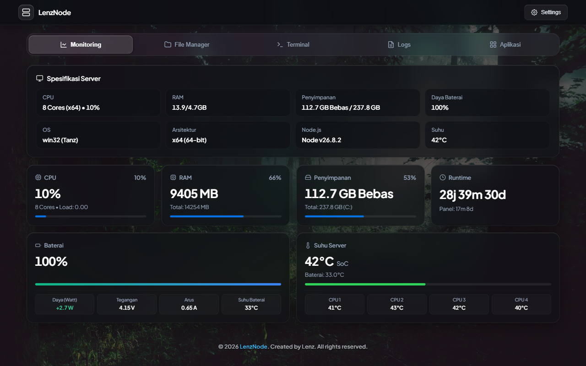
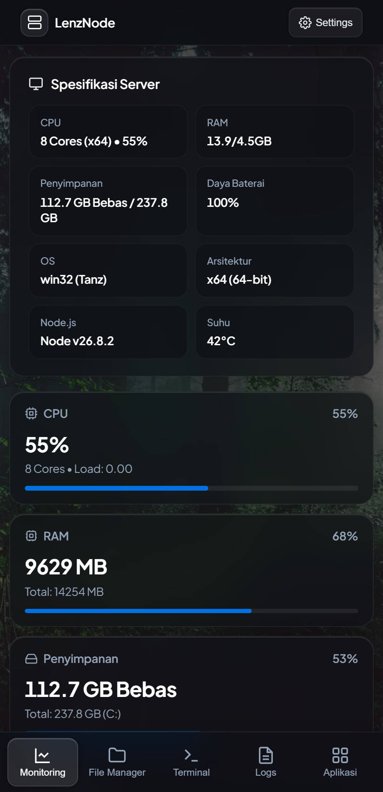
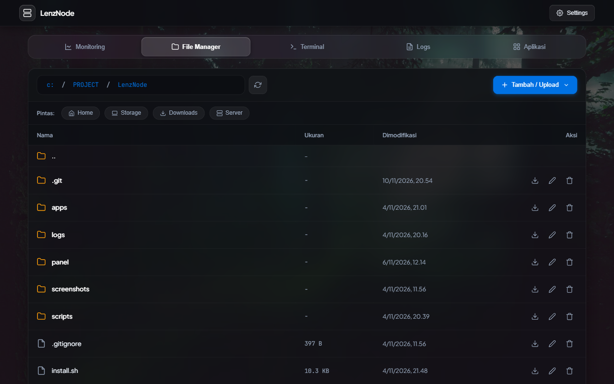
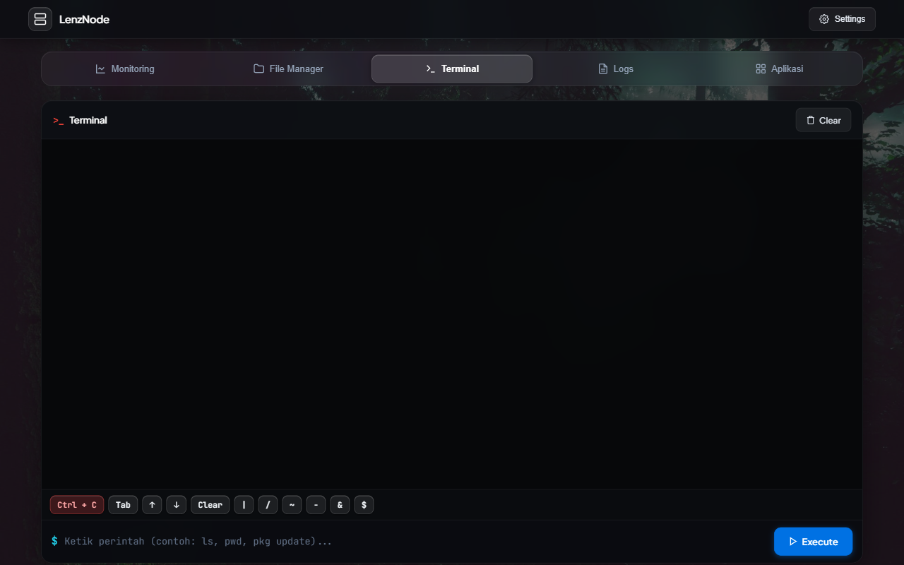
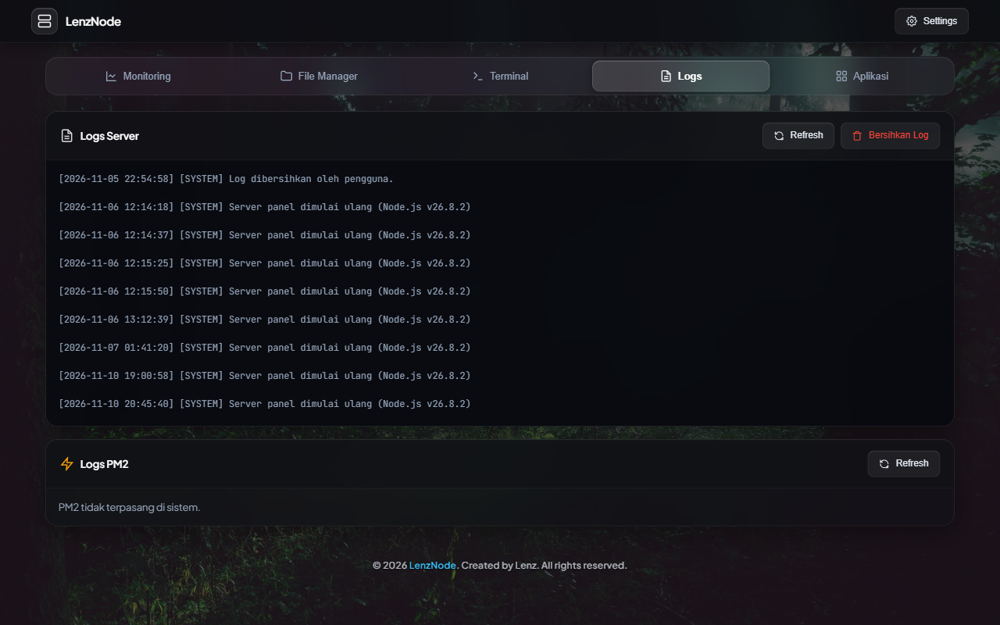

# LenzNode — Mini Server & OpenSSH (Native Termux Edition)

Transformasikan smartphone Android (**Android 5.0 s/d 16+**, ARM32/ARM64/x86_64) menjadi **Mini Server Linux & OpenSSH** hemat daya, ringan, dan siap pakai 24/7.

> **Arsitektur Native Termux**: Berjalan tanpa PRootDistro (hemat RAM hanya ~30–50 MB, tanpa overhead CPU, hemat penyimpanan 2 GB, dan bebas risiko bootloop).

---

## Fitur Utama

* **Web Dashboard Glassmorphism (Port 8080)**
  * Antarmuka modern dengan dukungan tema gelap (*dark mode*) dan terang (*frosted glass*).
  * Kompresi otomatis HTTP (Gzip/Deflate) untuk transfer data cepat dan hemat kuota.
  * Keamanan autentikasi berbasis sesi dengan proteksi anti-brute force.
* **Monitoring Daya & Baterai (Android 5 – 16+)**
  * Deteksi telemetri pengisian daya real-time: **Watt (Daya)**, **Tegangan (Volt)**, **Arus (Ampere)**, dan **Suhu Baterai**.
  * Multi-Tier Scanner: Sysfs, Termux:API, dan Dynamic CPU Modeler (akurat di Android 14/15/16 tanpa root).
* **Monitoring Spesifikasi & Metrik Sistem**
  * Pantau beban CPU %, penggunaan RAM, sisa kapasitas storage, uptime sistem, serta sensor suhu SoC.
* **Akses Publik Bebas Blokir (Cloudflare Tunnel)**
  * Terhubung otomatis ke Cloudflare Tunnel untuk akses jarak jauh dari luar jaringan Wi-Fi tanpa port forwarding.
  * URL publik tunnel otomatis ditampilkan langsung di terminal saat server pertama kali dijalankan.
* **Web File Manager**
  * Akses direktori penyimpanan Termux (`~`) dan penyimpanan internal Android (`/sdcard`).
  * Upload, download (otomatis ZIP), buat berkas/folder, rename, delete, serta built-in text editor.
* **Web Terminal & Console**
  * Eksekusi shell Linux langsung dari browser dengan live streaming output, riwayat perintah, dan tombol interupsi Ctrl + C.
* **Manajer Log & PM2 Process Manager**
  * Monitoring live log server serta status proses Node.js di PM2 (Start, Stop, Restart, Log).
* **OpenSSH Server Native (Port 2222)**
  * Akses SSH aman dan cepat langsung ke shell Termux.

---

## Preview Tampilan Web Dashboard

| Dashboard Monitoring (Desktop) | Tampilan Mobile |
| :---: | :---: |
|  |  |

| Web File Manager | Web Terminal & Console |
| :---: | :---: |
|  |  |

| Server & PM2 Logs |
| :---: |
|  |

---

## Kebutuhan Sistem & Kompatibilitas

| Parameter | Spesifikasi Minimal | Rekomendasi |
| :--- | :--- | :--- |
| **Sistem Operasi** | Android 5.0 (Lollipop / SDK 21) | Android 7.0 s/d 16+ |
| **Arsitektur CPU** | ARM32 (`armhf`), x86 | ARM64 (`aarch64`), x86_64 |
| **Kebutuhan RAM** | 512 MB fisik | 1 GB – 2 GB+ |
| **Ruang Penyimpanan** | Minimal 250 MB | 1 GB+ |
| **Akses Root** | Tidak Perlu (Non-Root) | Non-Root (HP Root tetap didukung) |
| **Pemakaian RAM Idle** | ~35 MB – 55 MB | Sangat hemat baterai |

---

## Panduan Instalasi (1 Perintah)

Buka aplikasi **Termux**, lalu jalankan perintah berikut:

```bash
pkg update -y && pkg upgrade -y && pkg install -y git
git clone https://github.com/Lenzx999/LenzNode.git
cd LenzNode
bash install.sh
```

> **Tips Kompatibilitas Android 14–16 & Solusi Pustaka Termux**:
> Jika Termux Anda menampilkan pesan `CANNOT LINK EXECUTABLE "curl"` (*cannot locate symbol SSL_set_quic_tls...*) atau `No mirror or mirror group selected`, jalankan perintah sinkronisasi sistem berikut:
> ```bash
> apt update && apt full-upgrade -y
> ```
> Gunakan aplikasi Termux resmi dari **F-Droid** atau GitHub Releases (bukan dari Google Play Store yang sudah usang).

---

## Cara Menjalankan Server (Lokal & Publik)

Setelah instalasi selesai, Anda dapat menjalankan server kapan saja menggunakan skrip kontrol atau alias global `lenznode`:

```bash
# Menjalankan server (Pilihan Interaktif: Dual Mode)
./start.sh
# atau cukup ketik:
lenznode
```

Saat dijalankan, Anda akan diberikan 2 opsi mode operasional:
* **[1] Lokal Saja (Wi-Fi / LAN)**: Sangat hemat RAM dan kuota internet. Cocok untuk digunakan di rumah/kantor dalam satu jaringan Wi-Fi.
* **[2] Public Tunnel (Cloudflare 24/7)**: Otomatis menghubungkan server ke Cloudflare Edge secara dinamis. Anda akan mendapatkan URL publik (`https://xxxx.trycloudflare.com`) yang bisa diakses dari mana saja tanpa perlu setting port forwarding modem.

### Perintah Langsung (Shorthand Commands)
```bash
./start.sh --local    # Langsung jalankan mode lokal (tanpa menu prompt)
./start.sh --tunnel   # Langsung jalankan dengan public tunnel Cloudflare
./start.sh status     # Cek status layanan (Panel, SSH, Tunnel, IP aktif)
./start.sh stop       # Hentikan semua proses server
./start.sh restart    # Mulai ulang server
./start.sh logs       # Pantau log live server
./start.sh update     # Update otomatis source code ke rilis terbaru GitHub
```

---

## Menjaga Server Tetap Aktif 24/7 di Latar Belakang

LenzNode telah dirancang agar **otomatis tetap menyala** di latar belakang selama aplikasi Termux dibuka, bahkan saat layar HP dimatikan:

1. **Wake-Lock Otomatis**: Skrip `start.sh` secara otomatis mengaktifkan fitur `termux-wake-lock` Android agar CPU tidak mengalami *deep sleep*.
2. **Matikan Penghemat Baterai Android (Wajib)**:
   * Buka *Pengaturan HP* > *Aplikasi* > *Termux* > *Baterai / Penggunaan Daya*.
   * Pilih **"Tidak Dibatasi" / "Jangan Optimalkan Baterai"** (*Unrestricted / Don't optimize*).
3. **Kunci Aplikasi Termux di Recent Apps**:
   * Buka menu *Recent Apps* (tampilan aplikasi yang berjalan), lalu tekan ikon gembok (*Lock*) pada aplikasi Termux agar tidak ditutup otomatis oleh pembersih RAM bawaan HP.

---

## Akses Dashboard & SSH

Saat server berjalan (`./start.sh` atau perintah `lenznode`), terminal akan menampilkan informasi alamat akses yang **100% dinamis dan realtime**:

```text
  ╭─ LenzNode ──────────────────────────────
  │  ●  panel       port 8080
  │  ●  ssh         port 2222
  │  ●  tunnel      connected (terverifikasi)
  │
  │  ➜  Local:    http://127.0.0.1:8080/
  │  ➜  Network:  http://192.168.1.15:8080/
  │  ➜  Public:   https://xxxx-xxxx.trycloudflare.com
  ╰─ Ready ─────────────────────────────────
```

* **Web Dashboard**: Buka browser di perangkat Anda (atau HP/Laptop lain dalam satu Wi-Fi) di URL `Network` atau melalui tautan `Public`.
  * **User default**: `admin`
  * **Password default**: `admin123` *(Dapat diganti pada menu Settings di Web Dashboard)*
* **SSH Remote Console**:
  ```bash
  ssh <user-termux>@<IP-HP> -p 2222
  ```

---

## Kompatibilitas Lintas Perangkat (Multi-Platform)

LenzNode tidak hanya optimal di Android Termux, tetapi juga kompatibel dengan berbagai lingkungan Linux dan Windows:
* **Smartphone Android**: Android 5.0 s/d 16+ (Termux Native, Non-Root).
* **Set-Top-Box (STB)**: Armbian, Alpine Linux, Debian/Ubuntu Server (HG680-P, B760H, dll).
* **Komputer / Laptop**: Linux (Ubuntu/Debian/Arch) dan Windows (via Node.js).

---

## Lisensi & Developer

* **Developer**: Lenz
* **Lisensi**: MIT License
