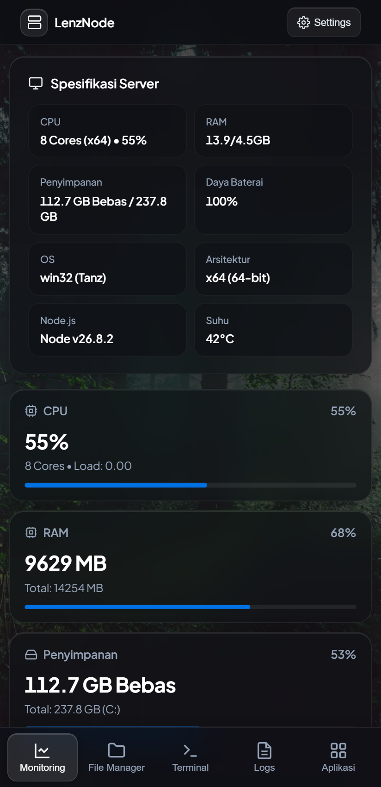
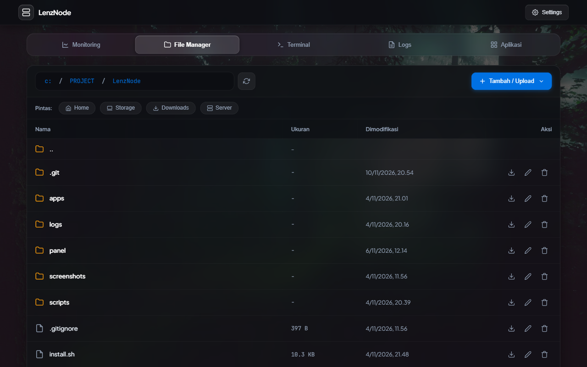
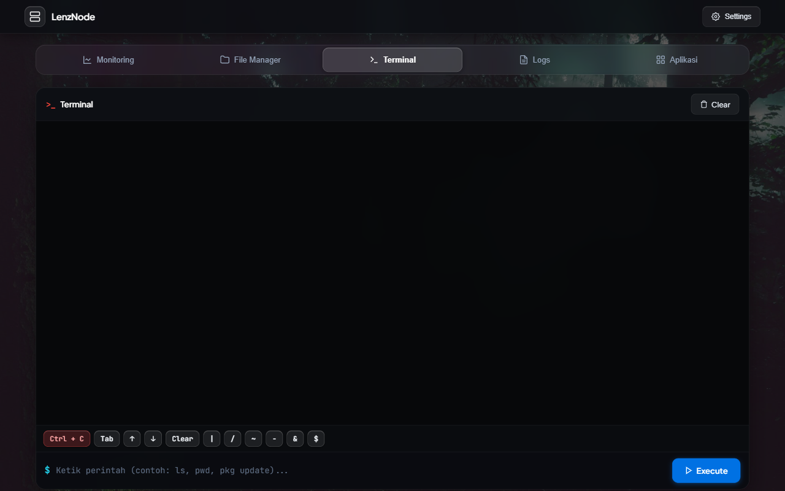
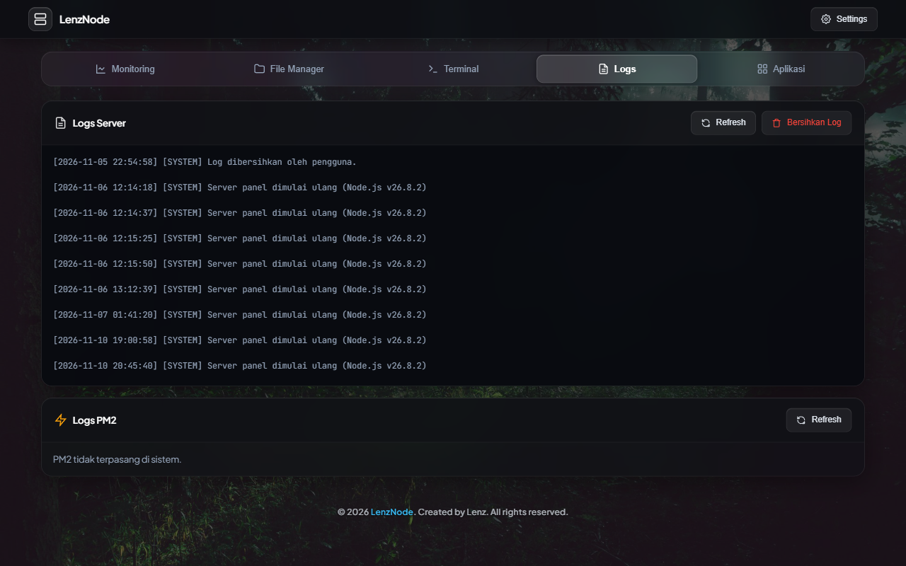

# LenzNode — Mini Server Android (Termux)

Ubah smartphone Android menjadi **Mini Server Linux & SSH pribadi** yang hemat daya, ringan, dan siap pakai 24 jam. Mendukung HP **Non-Root** maupun **Root (Magisk / KernelSU)**.

---

## Preview Tampilan Web Dashboard

| Dashboard Monitoring (Desktop) | Tampilan Mobile |
| :---: | :---: |
|  |  |

| Web File Manager | Web Terminal & Console |
| :---: | :---: |
|  |  |

| Server & PM2 Logs |
| :---: |
|  |

---

## Cara Pasang (Cukup 1 Baris)

Buka aplikasi **Termux**, salin perintah di bawah ini, tempel (*paste*), lalu tekan **Enter**:

```bash
pkg update -y && pkg install git -y && rm -rf LenzNode && git clone https://github.com/Lenzx999/LenzNode.git && cd LenzNode && bash install.sh
```

> **Catatan Penting**: Pasang aplikasi Termux resmi dari **[F-Droid](https://f-droid.org/packages/com.termux/)**. Jangan gunakan Termux dari Google Play Store karena sudah tidak aktif/kadaluwarsa.

---

## Cara Menjalankan Server

Ketik perintah berikut di Termux:

```bash
./start.sh
```
*(Atau cukup ketik: `lenznode`)*

Pilih mode yang diinginkan:
* **Ketik 1 (Mode Lokal)**: Untuk pemakaian di rumah / dalam satu Wi-Fi. Paling hemat RAM dan baterai.
* **Ketik 2 atau iya (Mode Publik)**: Server otomatis online 24/7 dan bisa dibuka dari mana saja lewat internet via Cloudflare Tunnel.

---

## Cara Membuka Dashboard Web

Setelah server berjalan, buka peramban (*Chrome / Browser*) di HP atau Laptop:
* **Dari HP itu sendiri**: Akses `http://127.0.0.1:8080`
* **Dari Laptop / HP Lain (Satu Wi-Fi)**: Akses alamat IP Wi-Fi yang tampil di layar (contoh: `http://192.168.1.3:8080`)
* **Dari Luar Rumah (Mode Publik)**: Akses link `https://xxxx.trycloudflare.com` yang muncul di layar.

**Data Akun Masuk (Login):**
* Username: `admin`
* Password: `admin123` *(Dapat diubah kapan saja di menu Pengaturan Dashboard)*

---

## Perintah Cepat

| Perintah | Fungsi |
| :--- | :--- |
| `./start.sh` | Menjalankan server |
| `./start.sh stop` | Mematikan server |
| `./start.sh restart` | Memulai ulang server |
| `./start.sh status` | Mengecek apakah server sedang aktif |
| `./start.sh update` | Memperbarui LenzNode ke versi terbaru |
| `./start.sh logs` | Melihat catatan (*log*) live server |
| `./start.sh report` | Ekspor berkas laporan error ke folder **Download** HP |
| `./start.sh --root` | Mengaktifkan Mode Root (jika perangkat di-root) |
| `./start.sh --non-root` | Mengembalikan ke Mode Non-Root standar |

---

## 3 Tips Supaya Server Menyala Terus 24 Jam

1. **Matikan Penghemat Baterai**: Buka *Pengaturan HP > Aplikasi > Termux > Baterai*, pilih opsi **"Tidak Dibatasi" (*Unrestricted*)**.
2. **Kunci Aplikasi Termux**: Buka menu aplikasi yang berjalan (*Recent Apps*), lalu tekan ikon **Gembok (*Lock*)** pada aplikasi Termux agar tidak tertutup pembersih RAM otomatis.
3. **Jika Ada Kendala / Error**: Cukup ketik perintah `./start.sh report`. Berkas laporan error otomatis tersimpan di folder **Download** HP (`LenzNode-Error.log`) sehingga bisa langsung dikirimkan ke developer untuk bantuan perbaikan.

---

## Dukungan HP Android

* **Android 7.0 s/d 16+**: 100% langsung lancar dan siap pakai (*Plug & Play*).
* **Android 5.0 & 6.0**: Bisa berjalan, tetapi harus menggunakan APK Termux versi lama (*Legacy v0.73*).
* **Kapasitas RAM**: Minimal 512 MB (disarankan pilih Mode 1 Lokal). Untuk RAM 1 GB ke atas bebas menggunakan Mode Lokal maupun Publik.
* **Mendukung Non-Root & Root**:
  * **HP Biasa (Non-Root)**: Berjalan aman tanpa perlu root HP.
  * **HP Root (Magisk / KernelSU)**: Otomatis terdeteksi dengan fitur tambahan port standar (80 & 22) dan shell root di terminal web.

---

## Lisensi & Pembuat

* **Developer**: Lenz
* **Lisensi**: MIT License
