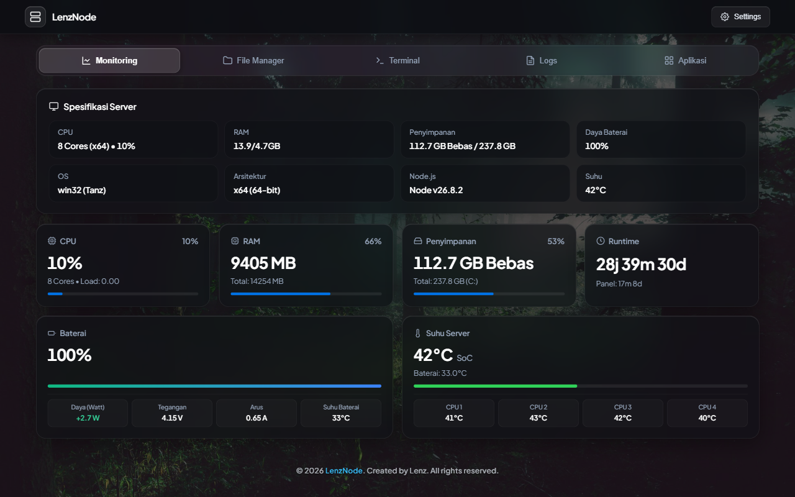

<div align="center">

  

  <br/><br/>

  <h1>LenzNode</h1>
  <p><strong>Mini Linux Server, Private Cloud Storage & AI Gateway for Android (Standalone APK & Termux)</strong></p>

  <p>
    Ubah smartphone Android bekas menjadi Mini Server Linux, Cloud Storage pribadi, dan AI Gateway mandiri yang hemat daya, ringan, dan siap beroperasi 24 jam nonstop tanpa perlu akses root.
  </p>

  <p>
    <a href="https://github.com/Lenzx999/LenzNode/releases"></a>
    
    
    
    <a href="CHANGELOG.md"></a>
    
  </p>

  <p>
    <a href="#-2-edisi-dalam-1-repositori">📦 2 Edisi Resmi</a> •
    <a href="#-edisi-1-android-apk-mandiri-tanpa-termux">📱 Android APK</a> •
    <a href="#-edisi-2-termux-native-cli">⚡ Termux Edition</a> •
    <a href="#-fitur-unggulan">✨ Fitur Unggulan</a> •
    <a href="#-cara-membuka-dashboard-web">🌐 Dashboard</a> •
    <a href="CHANGELOG.md">📝 Changelog</a>
  </p>

</div>

---

## 📦 2 Edisi dalam 1 Repositori

LenzNode kini hadir dalam **dua edisi resmi** yang berbagi satu mesin panel inti (`panel/server.js`) dan App Center yang sama:

| Edisi | Target Perangkat | Cara Pasang | Lingkungan Eksekusi |
| :--- | :--- | :--- | :--- |
| **Android APK Edition** | HP Android 7.0+ (Modern 64-bit & Lama 32-bit) | Pasang file `.apk` langsung, tanpa Termux | Ubuntu 22.04 minimal di dalam PRoot mandiri + Native Hardware Bridge |
| **Termux Edition** | Pengguna Termux (Android 5.0–16+ / Linux) | 1 baris perintah `bash install.sh` di Termux | Native Termux (tanpa PRoot, overhead nol) |

---

## 📱 Edisi 1: Android APK Mandiri (Tanpa Termux)

Cukup pasang APK, buka aplikasi, dan tunggu proses penyiapan otomatis selesai — seluruh runtime Linux (Ubuntu 22.04 minimal, Node.js LTS, OpenSSH Server, `cloudflared`, dan Web Dashboard LenzNode) langsung berjalan di latar belakang dengan *Foreground Service*, *WakeLock*, dan *WifiLock*.

### Pilih Varian APK Sesuai HP Anda

| File APK | Arsitektur (ABI) | Untuk Perangkat Apa? |
| :--- | :--- | :--- |
| `LenzNode-modern-arm64-v8a.apk` | `arm64-v8a` (64-bit) | Sebagian besar HP Android modern (Snapdragon/MediaTek/Exynos keluaran 2017 ke atas) |
| `LenzNode-lama-armeabi-v7a.apk` | `armeabi-v7a` (32-bit) | HP Android lama / entry-level 32-bit (Android 7–10 dengan CPU ARMv7) |

### Cara Menggunakan Edisi APK
1. Unduh APK yang sesuai dari halaman **[GitHub Releases](https://github.com/Lenzx999/LenzNode/releases)** (atau hasil build di tab **Actions**).
2. Pasang APK di HP Android (izinkan pemasangan dari sumber tidak dikenal jika diminta).
3. Buka aplikasi **LenzNode**, lalu pilih salah satu mode operasi:
   * **Jadikan HP Ini Server (Host Mode)**: Otomatis mengunduh rootfs Ubuntu 22.04 minimal, memasang dependensi inti (`openssh-server`, `node`, `git`, `curl`, `cloudflared`), dan menampilkan Web Dashboard LenzNode (`http://127.0.0.1:8080`). Pengguna bebas memasang paket apa saja via `apt install` di Web Terminal/SSH serta melakukan **OTA Update 1-Klik** langsung dari GitHub.
   * **Akses Server HP Lain (Remote Client Mode)**: Hubungkan aplikasi ke perangkat LenzNode lain (atau server Termux) cukup dengan memasukkan **Alamat Server** (IP Wi-Fi LAN atau URL Cloudflare Tunnel) dan **Token Akses (`lnz_...`)** yang tersedia di menu *Pengaturan ➜ Jaringan & Tunnel ➜ Akses Aplikasi Remote*.
4. Pada mode server, izinkan pengecualian optimasi baterai (*Ignore Battery Optimizations*) saat diminta agar server tetap hidup 24 jam di latar belakang.

> **Catatan Teknis & Keamanan**: APK menggunakan `targetSdkVersion = 28` agar kebijakan SELinux Android mengizinkan eksekusi binary di dalam lingkungan PRoot terminal secara penuh, menyertakan **Native Hardware Bridge** lokal (`127.0.0.1:48080`) untuk sensor baterai/suhu/senter/getar/wakelock, serta memproteksi aset runtime di dalam bundel terenkripsi (`lenznode-bundle.dat`) dengan minifikasi R8 pada build rilis.

---

## ⚡ Edisi 2: Termux Native CLI

Buka aplikasi **Termux**, salin perintah di bawah ini, tempelkan (*paste*), lalu tekan **Enter**:

```bash
pkg update -y && pkg install git -y && rm -rf LenzNode && git clone https://github.com/Lenzx999/LenzNode.git && cd LenzNode && bash install.sh
```

> **Catatan**: Unduh dan pasang Termux resmi dari **[F-Droid](https://f-droid.org/packages/com.termux/)**. Jangan gunakan versi Play Store karena sudah kadaluwarsa.

### Perintah CLI `lenz` (Khusus Termux / Linux)

Setelah terpasang, Anda bisa mengendalikan server dari mana saja di terminal Termux dengan perintah:

| Perintah | Deskripsi |
| :--- | :--- |
| `lenz status` | Menampilkan status aktif web panel, SSH, Cloudflare tunnel, dan apps |
| `lenz update` | Memeriksa dan memperbarui LenzNode ke versi terbaru dari GitHub |
| `lenz restart` | Memulai ulang seluruh layanan server |
| `lenz stop` | Menghentikan semua layanan server |
| `lenz logs` | Memantau catatan aktivitas (*live logs*) secara langsung |
| `lenz report` | Mengekspor berkas diagnosa error ke folder **Download** HP |

*(Perintah bawaan `./start.sh` tetap didukung penuh).*

---

## ✨ Fitur Unggulan

* **📊 Web Dashboard Interaktif**: Pemantauan beban sistem (*CPU, RAM, Storage, Baterai, Suhu*) secara waktu nyata (*real-time*) dengan tema Gelap (*Obsidian Dark*) dan Terang (*Clean Glass*).
* **🔄 Pembaruan Sistem 1-Klik (OTA Headless)**: Perbarui sistem server ke versi terbaru langsung dari browser tanpa perlu menyentuh terminal di smartphone.
* **📦 App Center Marketplace**: Pasang aplikasi server siap pakai dengan satu kali klik:
  * **9Router** (*Port 20128*): Multi-Model AI Router & penghemat token coding tools (Claude Code, Cursor, Antigravity, dll).
  * **Nextcloud** (*Port 8088*): Cloud storage pribadi untuk sinkronisasi berkas antar-perangkat, kalender, dan kolaborasi mandiri.
  * **Immich** (*Port 2283*): Solusi backup otomatis foto & video mandiri berkinerja tinggi sebagai alternatif Google Photos.
* **📂 Web File Manager**: Kelola, unggah, unduh, dan edit berkas server langsung dari browser tanpa perlu FTP/SFTP.
* **💻 Web Terminal & Console**: Akses shell Linux langsung dari antarmuka web dengan dukungan riwayat perintah dan pintasan keyboard.
* **🌐 Cloudflare Tunnel Otomatis**: Server otomatis bisa diakses dari mana saja melalui internet publik tanpa butuh IP publik statis atau konfigurasi port forwarding.
* **⚡ Perintah CLI Global `lenz`**: Kelola server dengan perintah singkat dan mudah diingat dari direktori mana saja pada edisi Termux.

---

## 🌐 Cara Membuka Dashboard Web

Setelah server dijalankan (baik lewat APK maupun Termux), buka peramban (*Chrome / Firefox*) di HP atau Laptop (atau gunakan langsung layar utama aplikasi pada edisi APK):

* **Dari HP itu sendiri**: Buka `http://127.0.0.1:8080`
* **Dari Laptop / HP Lain (Satu Wi-Fi)**: Buka alamat IP lokal yang tampil di dashboard/terminal (contoh: `http://192.168.1.3:8080`)
* **Dari Luar Rumah (Mode Publik)**: Buka tautan Cloudflare Tunnel yang tampil di dashboard, terminal, atau log status.

**Kredensial Masuk (Login):**
* Username: `admin`
* Password: `admin123` *(Dapat diubah kapan saja pada menu Pengaturan Dashboard — otomatis tersinkron dengan password SSH port `2222`)*

---

## 🔋 3 Tips Agar Server Menyala 24 Jam Nonstop

1. **Matikan Penghemat Baterai**: Buka *Pengaturan HP > Aplikasi > LenzNode (atau Termux) > Baterai*, lalu pilih opsi **"Tidak Dibatasi" (*Unrestricted*)**.
2. **Kunci Aplikasi di Recent Apps**: Buka menu aplikasi yang berjalan (*Recent Apps*), lalu aktifkan ikon **Gembok (*Lock*)** pada **LenzNode** / **Termux** agar tidak terhapus pembersih RAM bawaan sistem.
3. **Ketik `lenz report` Jika Ada Kendala (Termux)**: Untuk pengguna Termux, jalankan `lenz report` guna mengekspor berkas log diagnosa ke folder `Download/LenzNode-Error.log`. Pada edisi APK, pantau log langsung melalui konsol boot atau Web Terminal.

---

## ⚙️ Kompatibilitas & Arsitektur Build CI

* **Edisi APK**: Android 7.0+ (`minSdk = 24`, `targetSdk = 28`), mendukung arsitektur **Modern 64-bit (`arm64-v8a`)** dan **Lama 32-bit (`armeabi-v7a`)**.
* **Edisi Termux**: Android 5.0 hingga 16+ (Non-Root dan Root Magisk/KernelSU).
* **RAM Minimum**: 512 MB (disarankan Mode Lokal). Untuk RAM 1 GB ke atas bebas menggunakan Mode Lokal maupun Mode Publik.
* **Pipeline Build APK Otomatis (`.github/workflows/build-apk.yml`)**:
  * Repositori git tidak menyimpan binary `.so` besar (`jniLibs/`) maupun salinan bundle sementara (`assets/lenznode-bundle/`).
  * Setiap workflow CI menjalankan `bash android-app/scripts/fetch-android-bins.sh` untuk mengunduh & memverifikasi binary PRoot (`proot`, `libtalloc`, `libandroid-shmem`) dari repositori resmi Termux dan `busybox-static` dari Alpine Linux v3.20 untuk kedua ABI (`arm64-v8a` & `armeabi-v7a`), sekaligus membundel `panel/`, `apps/`, `scripts/`, `version.json`, dan `CHANGELOG.md` terbaru.
  * CI menjalankan unit test (`./gradlew testDebugUnitTest`), Android Lint (`./gradlew lintDebug`), membangun kedua split APK rilis, memverifikasi struktur APK dengan `aapt2` & `apksigner`, lalu mengunggah `LenzNode-modern-arm64-v8a.apk` dan `LenzNode-lama-armeabi-v7a.apk` sebagai Artifacts (serta melampirkan ke GitHub Release saat tag `v*` di-push).

---

## 📝 Catatan Rilis

Riwayat lengkap pembaruan fitur, perbaikan bug, dan optimasi dapat dilihat di berkas [**CHANGELOG.md**](CHANGELOG.md).

---

## 📄 Lisensi & Pengembang

* **Developer**: Lenz ([@Lenzx999](https://github.com/Lenzx999))
* **Personal Web / Portofolio**: [lenznity.my.id](https://lenznity.my.id)
* **Lisensi**: MIT License
